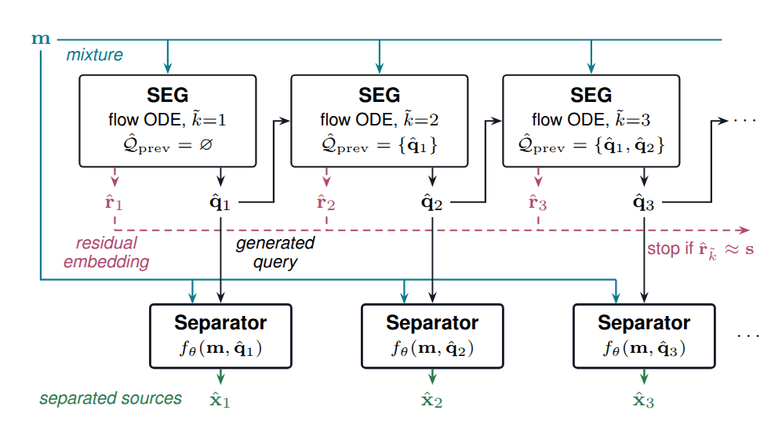

# MuS3D: Music Source Separation via Stem Discovery

Code for the paper *Music Source Separation via Stem Discovery*.

[Sound examples](http://research.spa.aalto.fi/publications/papers/mus3d/) | [Paper (arXiv)](https://arxiv.org/abs/2609.30912) | [Model checkpoints](https://huggingface.co/remus-aalto/MuS3D)



*Block diagram of the proposed MuS3D framework for the first three iterations, each of which separates one source or stem group.*

## Overview

MuS3D separates a music mixture without being told which sources it contains.
A stem embedding generator (SEG), a Transformer trained with conditional flow matching, runs recursively: at each iteration it generates a query embedding (PaSST, reduced to 128 dimensions with PCA) together with a residual embedding describing the sources still to be extracted.
 Each SEG iteration is conditioned on the mixture and on the queries generated so far.
 The recursion stops when the residual matches a fixed stop symbol (the least-variance PCA direction).
 Each query is passed to a query-conditioned separator that extracts that source: a DiT fine-tuned from SAM-Audio large, or a BS-Locoformer.

## Layout

    src/source_embedding_generator/     SEG (recursive flow matching), checkpoint loading
    src/classifiers/                    stem classifier (names SEG queries) and multi-label classifier baseline
    src/query_conditioned_dit/          DiT separator (SAM-Audio large, DAC-VAE latents)
    src/query_conditioned_bslocoformer/ query-conditioned BS-Locoformer, PaSST/PCA query model, SNR loss
    src/static_bslocoformer/            static VDBGPO BS-Locoformer baseline
    src/data/                           MoisesDB/MedleyDB/AlbumDB loaders and effect-chain augmentation
    configs/                            Hydra configs (SEG, DiT_separator, BSLocoformer_separator, BSLocoformer_static)
    evaluation/                         paper-table reproduction scripts
    dataset/                            dataset preparation (training data, test set), MoisesDB splits
    results_paper/                      per-item results behind the paper tables

## Installation

Requires Python >= 3.13 and [uv](https://docs.astral.sh/uv/). Dependencies are
pinned in `pyproject.toml` / `uv.lock`:

    uv sync

The scripts use `uv run python` with `PYTHONPATH=src`. Training logs to
Weights & Biases; set `WANDB_API_KEY`.

## Checkpoints and paths

Download the [checkpoints](https://huggingface.co/remus-aalto/MuS3D) to `checkpoints/`, next to the
model configs already there. The per-item
results behind the paper tables are in `results_paper/`. Other locations are
set with environment variables:

| Variable | Default | Content |
|---|---|---|
| `MUS3D_CHECKPOINTS` | `checkpoints/` | paper checkpoints (SEG, separators, classifiers) |
| `DATASET_ROOT` | `data/` | raw corpora and prepared training data |
| `MUS3D_TEST_SET` | `test_set/` | test set |
| `IR_ROOT` | (none) | impulse responses for training augmentation |

## Data

Training uses MoisesDB (with the [Banquet splits](https://github.com/kwatcharasupat/query-bandit/blob/main/reproducibility/splits.csv)), supplemented with 125 songs
from MedleyDB and 10 from AlbumDB, organized to match the MoisesDB taxonomy.
The test set is the MoisesDB test split in 10 s segments. Put the raw corpora in
`$DATASET_ROOT`:

    MoisesDB/moisesdb_v0.1/     MoisesDB v0.1
    MedleyDB/all_v1v2/          MedleyDB v1 and v2 (training only)
    AlbumDB/stems_mixed/        AlbumDB (training only)

and build everything with one script:

    bash dataset/prepare_datasets.sh          # or: ... train | test

`test` needs only MoisesDB and writes about 49 GB. Training also uses the impulse
responses listed in `configs/data/ir_index_filtered_v2.csv` (ReverbFx,
ASH-IR-Dataset, QMUL, MIT_RIRs), one folder each under `$IR_ROOT`.

## Training

All scripts work with `bash` or `sbatch` and accept Hydra overrides. Set `OUT`
(and `RUN`) to choose the output directory.

| Model | Script | Config | Trained parameters |
|---|---|---|---|
| SEG | `train_seg.sh` | `SEG.yaml` | 37 M |
| DiT separator | `train_dit_separator.sh` | `DiT_separator.yaml` | 2.3 B |
| BS-Locoformer separator | `train_bslocoformer_separator.sh` | `BSLocoformer_separator.yaml` | 31 M |
| Static BS-Locoformer (VDBGPO baseline) | `CONFIG=BSLocoformer_static train_bslocoformer_separator.sh` | `BSLocoformer_static.yaml` | 73 M |

    bash train_seg.sh                                   # SEG
    MODEL=SEG_resemb bash train_seg.sh                  # SEG with residual embedding
    bash train_dit_separator.sh                         # fine-tunes SAM-Audio large, see below
    bash train_bslocoformer_separator.sh                # query-conditioned BS-Locoformer
    CONFIG=BSLocoformer_static bash train_bslocoformer_separator.sh   # static baseline

The DiT separator is initialized from SAM-Audio large: the released
`facebook/sam-audio-large` checkpoint (Hugging Face access required) is
downloaded and converted to this backbone when the model is built
(`src/query_conditioned_dit/sam_audio_init.py`). Set `INIT=/path/to/checkpoint.pt`
to use a local copy.

The DiT separator is mono (the DAC-VAE has no stereo mode). Resume any run with
`trainer.ckpt_dir=<output_dir>/ckpt/latest`; evaluate `ckpt/latest`, not `ckpt/best`.

## Inference

    bash inference.sh song.wav --out output/inference
    bash inference.sh song.wav --separator bslocoformer --level track

A 10 s segment (centred by default, or `--start <s>`) is decomposed recursively
by SEG; each query is separated by the chosen separator and named by the stem
classifier. Main options (`--help` for all):

- `--separator {dit,bslocoformer}` (default `dit`)
- `--level {stem,track}`: instrument groups or individual instruments
- `--seg_ckpt`, `--sep_ckpt`, `--classifier`: checkpoint paths
- `--seg_steps`, `--seg_churn`, `--sep_steps`, `--sep_churn`, `--max_steps`, `--seed`, `--device`

Defaults are the paper's blind MuS3D settings (SEG: 32 ODE steps, churn 0.1;
DiT: EMA weights, 32 steps, churn 0.5). Outputs go to `--out/<input name>/`:
`mixture.wav`, one `<name>.wav` per discovered source (`<name>_2.wav` for
repeats), and `trace.txt` with the extraction order and each step's stop cosine.

## Evaluation

`reproduce_tables.py` alone reproduces both paper tables from `results_paper/`:

    uv run python evaluation/reproduce_tables.py

To regenerate the separated audio from the checkpoints and score it again, build
the test set ([Data](#data)) and run the stages below. Every segment is seeded
from its own name, so a rerun gives the same audio.

    uv run python evaluation/generate_estimates.py seg --out <dir>          # stem discovery
    uv run python evaluation/generate_estimates.py classifiers --out <dir>  # Oracle and Multi-label Classifier rows
    uv run python evaluation/generate_estimates.py mus3d_dit --out <dir>    # blind separation
    uv run python evaluation/generate_estimates.py mus3d_loco --out <dir>
    uv run python evaluation/build_release.py --release <dir> --no-require-models
    uv run python evaluation/generate_estimates.py oracle_dit --out <dir>   # oracle separation
    uv run python evaluation/generate_estimates.py oracle_loco --out <dir>
    uv run python evaluation/build_release.py --release <dir>

Each `generate_estimates.py` stage takes `--shard i/n` to split the work over
several GPUs. Then score the estimates and print both tables:

    export RESULTS_PAPER=<dir>/results_paper
    uv run python evaluation/reproduce_separation_from_audio.py snr
    uv run python evaluation/reproduce_separation_from_audio.py mert
    uv run python evaluation/reproduce_separation_from_audio.py judge   # SAM-Audio environment
    uv run python evaluation/reproduce_tables.py

`reproduce_tables.py` checks every cell against the published value. The audio of
the baselines is not regenerated; their released scores are reused. The Judge stage needs `facebook/sam-audio-judge`
and runs in a SAM-Audio environment (`SAM_AUDIO_REPO`); the other stages run here.

The only baselines trained with this code are the static BS-Locoformer and the
multi-label classifier. The others (HTDemucs, Banquet, SAM-Audio, MusicFlamingo)
are the publicly released models.

## Tests

The tests use Python's built-in `unittest` (no extra packages). Run them from the
repository root.

**Fast tests** (CPU, a few seconds, no data or downloads): configs compose,
data-sampling protocol, SEG/DiT/BS-Locoformer forward passes on small random
models, SAM-Audio weight conversion, scheduler, classifiers and the evaluation
scoring.

    uv run python -m unittest discover tests

Run a single file, class or test:

    uv run python -m unittest tests.test_fast
    uv run python -m unittest tests.test_fast.TestSEGBackbone
    uv run python -m unittest -v tests.test_fast.TestProtocol.test_sample_recursive_partitions_units

**Slow tests** (skipped unless `MUS3D_SLOW_TESTS=1`): load the paper checkpoints
(SEG, SEG with residual embedding, DiT, both BS-Locoformers), run a short SEG
recursion, and check that `evaluation/reproduce_tables.py` reproduces every
published cell. They need the checkpoints and the test set, and download PaSST
and DAC-VAE on first use. The DiT needs about 10 GB of free memory; use `CUDA_VISIBLE_DEVICES=`
to run on CPU if the GPU is busy.

    MUS3D_SLOW_TESTS=1 uv run python -m unittest -v tests.test_checkpoints

## Citation

```bibtex
@article{kallinen2026mus3d,
  title   = {Music Source Separation via Stem Discovery},
  author  = {Kallinen, V. Valtteri and Moliner, Eloi and Juvela, Lauri and V{\"a}lim{\"a}ki, Vesa},
  journal = {arXiv preprint arXiv:2609.30912},
  year    = {2026},
  url     = {https://arxiv.org/abs/2609.30912}
}
```

## License

The code is released under the MIT License ([LICENSE](LICENSE)), except the DiT
separator in `src/query_conditioned_dit/` and its checkpoints, which derive from
SAM-Audio and are distributed under the SAM License
([src/query_conditioned_dit/LICENSE](src/query_conditioned_dit/LICENSE)). Using
them means accepting that license, including acknowledging the SAM Materials in
publications. The BS-Locoformer code in `src/query_conditioned_bslocoformer/` and
`src/static_bslocoformer/` derives from tf-locoformer (Apache-2.0,
[LICENSE-APACHE](LICENSE-APACHE)) and spectral_feature_compression (MIT); the
copyright notices are in the file headers.
